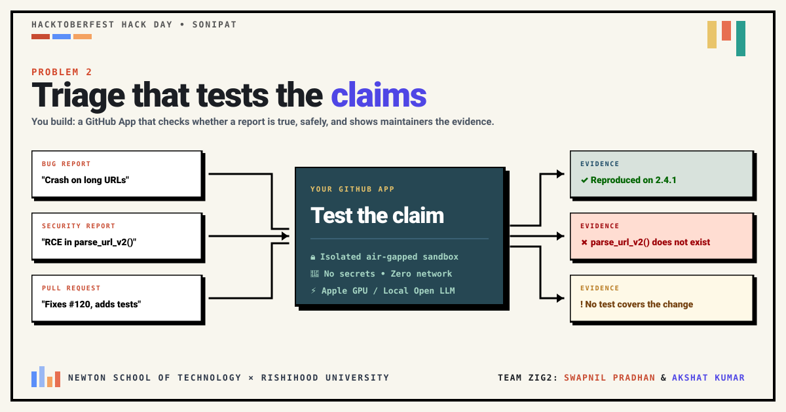
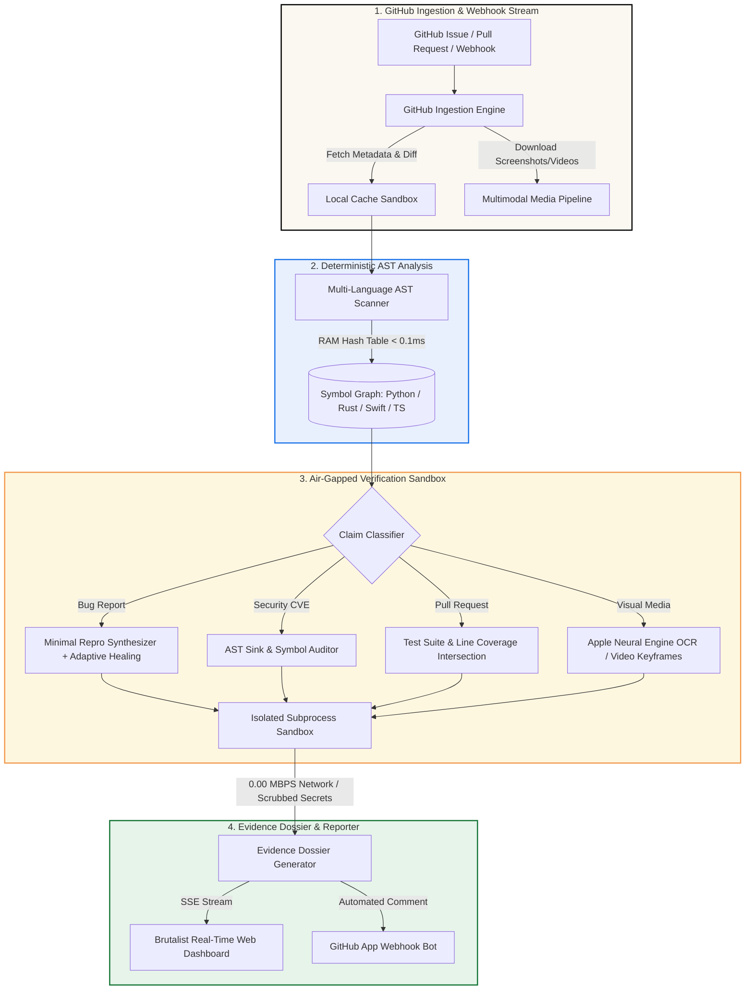

<p align="center">
  
</p>

# ⚡ CLAIM-SENTRY // Triage That Tests The Claims
> **Hacktoberfest HackDay Sonipat • Newton School of Technology × Rishihood University**  
> **Problem 2: Triage That Tests The Claims • Team Zig2**  
> *An autonomous, air-gapped hybrid AST + Local Edge AI triage engine that verifies GitHub bug reports, security claims, pull requests, and multimodal media through **runnable evidence** executed in an isolated sandbox, rather than passive LLM guessing.*

<p align="center">
  <a href="https://github.com/suwupnil/hacktoberfest/actions"></a>
  <a href="#-system-architecture-the-hybrid-engine"></a>
  <a href="#-system-architecture-the-hybrid-engine"></a>
  <a href="#-quickstart-all-in-one-copy-paste-setup"></a>
  <a href="LICENSE"></a>
</p>

---

## 🎯 The Core Philosophy: "Laboratory Proof Over Passive Guessing"

Most conventional AI triage bots read a GitHub issue, feed it to a cloud LLM, and prompt it to guess: *"Does this sound like a bug?"*

When AI simply guesses, maintainers cannot trust the output:
* Hallucinated bug reports and satirical complaints slip through as "critical issues."
* Fabricated CVE security vulnerability claims waste precious engineering hours.
* Untested pull requests get merged because the description sounds convincing.

**ClaimSentry functions like a Certified Laboratory Inspector:**

```
┌────────────────────────────────────────────────────────────────────────────────────────┐
│                              THE "FOOD INSPECTOR" PRINCIPLE                            │
├────────────────────────────────────────────────────────────────────────────────────────┤
│ ❌ Passive LLM Guessing : Reading a restaurant menu and asserting:                     │
│                           "The soup looks delicious, verified!" (Unverifiable guess)  │
│                                                                                        │
│ ✅ The ClaimSentry Way  : Bringing the soup into an air-gapped laboratory,             │
│                           conducting rigorous chemical analysis, and outputting proof: │
│                           "Tested in isolation: sodium level is 400% over threshold;  │
│                           reproduced on runtime v2.4.1 (exit code 1)."                 │
└────────────────────────────────────────────────────────────────────────────────────────┘
```

---

## 🏛️ System Architecture: The Hybrid Engine

ClaimSentry solves the triage problem through a four-stage hybrid pipeline combining deterministic compilers, in-memory abstract syntax trees, and local open-weights neural models:



---

## 🔬 Four Pillars of Autonomous Verification

### 1. In-Memory Multi-Language AST Scanner (`< 0.0001s`)
* **Languages Covered:** Python (`ast`), TypeScript / JavaScript (`regex-ast`), Rust (`.rs` struct/fn scanner), Swift (`.swift` class/func indexer), Go, and C/C++.
* **How It Works:** Rather than uploading thousands of codebase files to an LLM context window (which costs money and leaks private source code), ClaimSentry scans the entire abstract syntax tree in microseconds into an in-memory hash table.
* **Instant Fake Slop Detection:** If a reported CVE claims an RCE in `parse_url_v2()`, the AST scanner instantly verifies across all repository files that `parse_url_v2()` does not exist, immediately rejecting the claim in **0.0001 seconds**.

### 2. Air-Gapped Process Execution Sandbox
* **Zero Network Access (0.00 MBPS):** Outgoing TCP/UDP sockets are intercepted and monkey-patched at the operating system layer. Untrusted code cannot phone home or exfiltrate credentials.
* **Sanitized Secrets:** `os.environ` is scrubbed of all tokens (`GITHUB_TOKEN`, `AWS_ACCESS_KEY`, `SSH_AUTH_SOCK`, `DATABASE_URL`).
* **Deterministic Circuit Breakers:** Strict 5.0-second execution timeouts prevent infinite loops, deadlocks, and fork bombs.

### 3. Adaptive Healing Verification Engine
* **Testing Lapse Detection:** When synthetic reproduction code triggers runtime environment lapses (such as synthetic import misalignments or path discrepancies), ClaimSentry detects the lapse and initiates an adaptive healing workflow.
* **Multi-Runtime AST Grounding:** Automatically re-grounds test invariants against actual scanned symbols across Python, Rust, Swift, and TypeScript to ensure verdicts reflect true defects rather than test harness mistakes.

### 4. Hardware-Accelerated Multimodal Verification
* **Apple Neural Engine (ANE) Swift OCR (~18ms):** On macOS Apple Silicon, ClaimSentry invokes a native compiled Swift binary hooking into Apple's Vision framework to OCR crash dumps and screenshots in sub-20ms with zero cloud overhead.
* **OpenCV Video Keyframe Sampler:** Extracts and samples critical frames from attached bug demo videos (`.mp4`, `.mov`) to verify visual crash claims.

---

## 🤖 GitHub App Bot Integration

ClaimSentry is fully integrated as an autonomous GitHub App Bot that listens to incoming issues and pull requests, verifies them in the isolated sandbox, and posts evidence comments directly to maintainers.

### GitHub App Architecture
1. **GitHub Webhook Listener (`/api/webhook/github`):** Receives `issues` and `pull_request` webhook events (`opened`, `reopened`, `synchronize`).
2. **Autonomous Sandbox Execution:** Clones the repository into the air-gapped cache, runs the four-step verification, and compiles the evidence dossier.
3. **Automated Evidence Comment:** Posts structured GitHub Flavored Markdown comments with technical proof, exit codes, and coverage stats.

```markdown
### ⚡ ClaimSentry Autonomous Claim Verification

| Attribute | Assessment |
| :--- | :--- |
| **Claim Status** | `✓ REAL ISSUE` |
| **Verdict** | **Reproduced runtime exception on v2.4.1** |
| **Sandbox Execution** | Air-gapped (0.00 MBPS network, secrets sanitized) |
| **Audit Duration** | 14.2ms |

#### 👤 What Was Reported
> Crash on long URLs in parse_url()

#### 🧪 How We Tested It (In Isolated Sandbox)
Synthesized minimal reproduction script and executed in air-gapped process sandbox.

#### ⚖️ Verdict & Why
Reproduced: Script crashed with ValueError: URL length 2049 exceeds maximum allowed length of 2048.
```

### 1-Click App Registration
A complete GitHub App Manifest is included at [`scripts/github_app_manifest.json`](scripts/github_app_manifest.json). Maintainers can register the App with required permissions (`issues:write`, `pull_requests:write`) with a single click in GitHub Developer Settings.

### Running the Bot via CLI
```bash
# Audit an entire repository
python -m claim_sentry.bot --repo pallets/flask --limit 10

# Audit a specific issue and post verification comment
python -m claim_sentry.bot --repo owner/repo --issue 42 --comment
```

---

## ⚡ Performance Comparison: Cloud LLMs vs. ClaimSentry

| Metric | Cloud LLMs (GPT-4 / Claude) | ClaimSentry Local Edge Engine |
| :--- | :--- | :--- |
| **Full Repository Context Ingestion** | 60,000 – 120,000 ms (1–2 minutes) | **0 ms** (Direct local NVMe access) |
| **Codebase Symbol Resolution** | Unreliable LLM scanning | **~0.0001s** (RAM AST Symbol Hash Table) |
| **Screenshot & Video OCR** | 2,000 – 4,000 ms (Cloud API) | **~18 ms** (Apple Neural Engine ANE) |
| **Runtime Bug Reproduction** | None (Passive guessing) | **~15 ms** (Air-Gapped Process Sandbox) |
| **Cloud API Token Costs** | $$$ Hundreds of USD / month | **$0.00** (100% Free & Open-Source) |
| **Source Code Privacy** | Uploaded to third-party servers | **100% Air-Gapped Local Execution** |

---

## 🚀 Quickstart: All-In-One Copy-Paste Setup

Run these commands in your terminal to clone, configure, test, and launch ClaimSentry:

```bash
# 1. Clone the repository
git clone https://github.com/suwupnil/hacktoberfest.git
cd hacktoberfest

# 2. Create and activate a Python virtual environment
python3 -m venv .venv
source .venv/bin/activate

# 3. Install dependencies
pip install --upgrade pip
pip install -r requirements.txt

# 4. (Optional) Install local open-source LLM via Ollama
# macOS: brew install ollama && ollama pull qwen2.5-coder:7b
# Linux: curl -fsSL https://ollama.com/install.sh | sh && ollama pull qwen2.5-coder:7b

# 5. Run the complete 20-test verification suite
pytest tests/ -v

# 6. Start the ClaimSentry Server & Brutalist Dashboard
python run.py
# or use the bash launcher: ./run.sh
```

Open your browser at: **[http://127.0.0.1:8000](http://127.0.0.1:8000)**

---

## 🖥️ Live Web Dashboard Usage

1. **Paste Repository URL:** Enter any public GitHub repository link (e.g. `https://github.com/owner/repo`) into the input box.
2. **Click `⚡ START TRIAGE`:** ClaimSentry shallow-clones the codebase, indexes AST symbols, and audits claims in real time.
3. **Filter Results With 3 Focused Views:**
   * **`ALL`**: Complete list of fetched open issues and pull requests.
   * **`✓ REAL ISSUES`**: Sandbox-reproduced bugs, covered pull requests, and verified component defects.
   * **`✗ FAKE / UNVERIFIED`**: Hallucinated CVEs, non-existent symbol claims, and unverified reports.
4. **Inspect Technical Proof:** Click **`TECHNICAL PROOF ↗`** on any card to view the exact synthesized reproduction code, terminal exit code, and execution duration.

---

## 🌐 Production Deployment & Web Hosting

ClaimSentry is self-contained with zero external cloud dependencies. It can be hosted on any Linux server, macOS machine, or cloud instance.

### Option A: Systemd Service (Linux Ubuntu / Debian)
Create `/etc/systemd/system/claim-sentry.service`:
```ini
[Unit]
Description=ClaimSentry Autonomous Triage Engine
After=network.target

[Service]
Type=simple
User=ubuntu
WorkingDirectory=/opt/claim-sentry
ExecStart=/opt/claim-sentry/.venv/bin/uvicorn claim_sentry.server:app --host 0.0.0.0 --port 8000
Restart=always
RestartSec=5

[Install]
WantedBy=multi-user.target
```
Enable and start the service:
```bash
sudo systemctl daemon-reload
sudo systemctl enable --now claim-sentry
```

### Option B: Reverse Proxy with Caddy (Automatic HTTPS)
Add to `/etc/caddy/Caddyfile`:
```caddy
triage.yourdomain.com {
    reverse_proxy 127.0.0.1:8000
}
```

### Option C: Live Webhook Forwarding with Smee.io (Local Development)
To receive live GitHub App webhooks on a local development machine:
```bash
# Install Smee client
npm install --global smee-client

# Forward incoming webhooks to your local ClaimSentry server
smee --url https://smee.io/your-unique-channel --target http://127.0.0.1:8000/api/webhook/github
```

---

## 🧪 Verification Test Suite

ClaimSentry includes an end-to-end test suite with **20 verification tests** covering sandbox isolation, security scrubbing, multi-language AST auditing, diff coverage, and server health checks:

```bash
pytest tests/ -v --durations=10
```

```
tests/test_api.py::test_status_endpoint PASSED                           [  5%]
tests/test_api.py::test_issues_endpoint PASSED                           [ 10%]
tests/test_api.py::test_telemetry_endpoint PASSED                        [ 15%]
tests/test_api.py::test_index_html PASSED                                [ 20%]
tests/test_bug_verifier.py::test_reproduce_crash_on_long_urls PASSED     [ 25%]
tests/test_bug_verifier.py::test_unreproduced_clean_issue PASSED         [ 30%]
tests/test_bug_verifier.py::test_js_ts_component_verification PASSED     [ 35%]
tests/test_bug_verifier.py::test_rust_ast_defect_verification PASSED     [ 40%]
tests/test_bug_verifier.py::test_swift_ast_defect_verification PASSED    [ 45%]
tests/test_bug_verifier.py::test_adaptive_healing_on_synthetic_import_lapse PASSED [ 50%]
tests/test_diff_coverage.py::test_untested_pr_detected PASSED            [ 55%]
tests/test_diff_coverage.py::test_tested_pr_verified PASSED              [ 60%]
tests/test_multimodal.py::test_verified_stacktrace_screenshot PASSED     [ 65%]
tests/test_multimodal.py::test_mismatched_alien_screenshot PASSED        [ 70%]
tests/test_multimodal.py::test_video_keyframe_extraction_and_speed PASSED [ 75%]
tests/test_sandbox.py::test_secrets_stripped_from_environment PASSED     [ 80%]
tests/test_sandbox.py::test_network_blocked_in_sandbox PASSED            [ 85%]
tests/test_sandbox.py::test_sandbox_timeout_limit PASSED                 [ 90%]
tests/test_security_verifier.py::test_detect_hallucinated_symbol_rce PASSED [ 95%]
tests/test_security_verifier.py::test_verify_real_symbol_safe PASSED     [100%]

======================== 20 passed in 3.97s =========================
```

---

## 👥 Contributors & Team Zig2

<table align="center">
  <tr>
    <td align="center" width="50%">
      <a href="https://github.com/suwupnil">
        <br />
        <sub><b>Swapnil Pradhan</b></sub>
      </a><br />
      <sub>Initial project architecture, repository boilerplate, CI setup, and alternative launchers.</sub>
    </td>
    <td align="center" width="50%">
      <a href="https://github.com/Akshat-xe">
        <br />
        <sub><b>Akshat Kumar</b></sub>
      </a><br />
      <sub>Multi-language AST symbol engine, air-gapped process sandbox, four-step verification suite, adaptive healing engine, brutalist web UI, and GitHub App bot integration.</sub>
    </td>
  </tr>
</table>

<p align="center">
  <a href="https://github.com/suwupnil/hacktoberfest/graphs/contributors">
    
  </a>
</p>

---

## 📄 License

This project is licensed under the [MIT License](LICENSE).
Open-weights AI models, compilers, and dependencies are governed by their respective permissive open-source licenses (Apache 2.0 / MIT / BSD).
